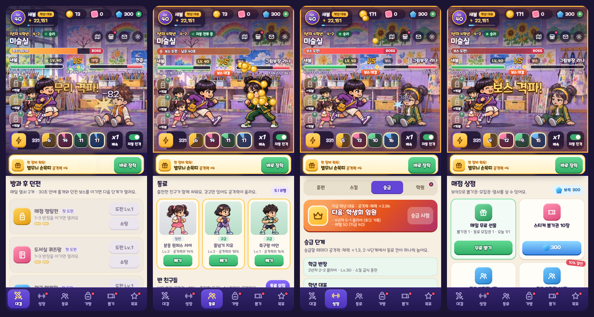

# 쉬는 시간의 왕!

해솔초등학교 1학년부터 6학년까지, 쉬는 시간마다 친구들과 대결하며 성장하는 **세로형 방치 RPG** 시제품입니다.



## 바로 해 보기

[`outputs/recess-king.html`](outputs/recess-king.html)을 내려받아 브라우저로 열면 됩니다. 그림·글꼴·코드가 모두 들어 있는 파일 하나라 인터넷 연결이 없어도 됩니다. 진행 상황은 그 브라우저에 저장됩니다.

## 들어 있는 것

- **자동 전투**: 친구 다섯과 무리 대장으로 된 무리 셋(18명)을 쓰러뜨린 뒤 1:1 보스 도전(40초)을 합니다. 넘친 피해는 다음 상대로 이어지고, 스킬은 뒤에 선 무리까지 맞힙니다.
- **끝없는 년차**: 6-3을 깨면 다음 년차로 넘어가며 상대와 보상이 계속 커집니다. 만·억·조…무량대수 단위로 표기합니다.
- **성장**: 훈련(25레벨마다 ×2), 장비 착용·강화, 스티커 뽑기와 도감, 매점 간식 버프, 과목 선택, 2배속, 일괄 강화가 있습니다.
- **전학(환생)**: 처음부터 다시 시작하는 대신 명예 배지를 받고, 방과 후 학원에서 영구 능력치를 올립니다.
- **매일 할 거리**: 방과 후 던전 3종(하루 열쇠 2개·소탕), 7일 출석, 일일 미션, 오프라인 보상(최대 8시간)이 있습니다.
- **승급·동료·스킬**: 승급 시험으로 칭호를 올려 크게 강해지고, 반 친구 8명을 모집해 함께 싸우고, 액티브 스킬 4종을 자동으로 씁니다.
- **보석·상점·우편·퀘스트·성장 패스**: 유료 재화 자리(보석)와 상점, 캐시 상품 자리(결제 연결 전 '준비 중'), 우편함, 퀘스트 가이드, 무료·프리미엄 성장 패스가 있습니다.

## 폴더

| 경로 | 내용 |
|---|---|
| `work/recess/` | 게임 소스(`index.html`, `style.css`, `game.js`, `ui.js`, `wardrobe.js`, 그림·글꼴). 수치 조절법은 [work/recess/README.md](work/recess/README.md) |
| `work/package_recess.py` | 소스를 `outputs/recess-king.html` 한 파일과 소스 압축본으로 묶습니다 |
| `work/check_recess*.py` | Playwright 검사(진행·전투·옷장·그림·년차/전학/던전·승급/동료/상점/우편/패스) |
| `work/tools/balance-sim.cjs` | 1~2년 진행 시뮬레이터. 결과는 `work/tools/balance-sim-result.txt` |
| `work/build_recess_*.py`, `work/*.jpg` | 그림 시트를 잘라 게임 그림으로 만드는 스크립트와 원본 시트 |
| `work/codex-art-request.md`, `work/codex-art-request-2.md` | 그림 작업 요청서(1차: 무리·던전, 2차: 승급 시험관·스킬·상점·배너) |

## 개발

```
cd work
py -I package_recess.py
py -I check_recess.py
py -I check_recess_combat.py
py -I check_recess_wardrobe.py
py -I check_recess_longterm.py
py -I check_recess_meta.py
node tools/balance-sim.cjs 730 16
```

검사에는 Python Playwright와 설치된 Chrome이 필요합니다.

## 저작권

- 글꼴: 넥슨 메이플스토리체(넥슨 무료 배포 서체)
- 게임 코드·설정·그림은 이 시제품을 위해 만든 것입니다.
